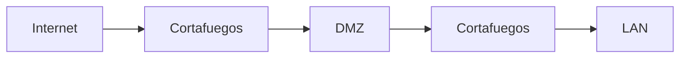

# Arquitectura y Segmentación de Red - Servicios de Torrent

## 1. Tabla de ubicación de servicios

| Servicio | Zona | Justificación |
| :--- | :--- | :--- |
| **1. Web corporativa pública** | DMZ | Está expuesta a Internet y debe ser accesible desde el exterior, pero no necesita acceso directo a la LAN. |
| **2. Servidor de correo** | DMZ | Recibe y envía correo desde Internet. Debe estar aislado de la red interna para limitar posibles ataques. |
| **3. Pasarela VPN** | DMZ | Permite conexiones remotas desde Internet. Debe estar aislada y controlar estrictamente el acceso a la LAN. |
| **4. Proxy (saliente e inverso)** | DMZ | El proxy inverso protege y filtra peticiones entrantes de Internet hacia los servidores de la DMZ, y el saliente intermedia las salidas de la LAN. |
| **5. HMI de planta y carpeta de planos** | Zona crítica | Contiene propiedad intelectual crítica y control industrial; no requiere exposición directa a Internet y su caída paralizaría la producción. |
| **6. Autoridad de certificación (srv-ca)** | Zona crítica | Gestiona certificados digitales y claves criptográficas. Su compromiso permitiría suplantar identidades y servicios de toda la organización. |
| **7. Servidor de copias de seguridad** | Zona crítica | Contiene información esencial para recuperar los sistemas. Debe estar muy protegido frente a ransomware y accesos no autorizados. |
| **8. Portátiles de ingenieros y operarios** | LAN | Son dispositivos corporativos utilizados por el personal para acceder a los recursos internos. Deben contar con autenticación y protección de dispositivos. |
| **9. Wi-Fi de invitados** | Zona propia | Los dispositivos invitados no son confiables y no deben tener acceso a la LAN ni a los sistemas industriales. Deben disponer únicamente de salida a Internet. |
| **10. Servidor de registros y monitorización** | LAN | Necesita recibir información de distintas zonas, pero también debe estar protegido para evitar la manipulación o eliminación de evidencias. |

---

## 2. Tabla de flujos de red

| Origen → destino | ¿Permitido? | Ejemplo concreto |
| :--- | :--- | :--- |
| **Internet → DMZ** | **Sí** (Restringido) | Un cliente externo accede por HTTPS (puerto 443) a la web corporativa pública o envía un correo por SMTP (puerto 25). |
| **Internet → LAN** | **No** | Cualquier intento de conexión directa desde Internet hacia los portátiles de operarios o el servidor de copias de seguridad es bloqueado por defecto. |
| **DMZ → LAN** | **No** (Salvo excepciones) | El servidor web tiene bloqueado iniciar conexiones hacia la carpeta de planos; solo se permiten flujos puntuales y filtrados como el envío de logs (Syslog) o autenticación. |
| **LAN → DMZ** | **Sí** (Controlado) | Un ingeniero desde su portátil accede a la interfaz de administración del proxy o consulta el correo interno alojado en la DMZ. |
| **LAN → Internet** | **Sí** (A través de Proxy) | Los portátiles de los empleados navegan por páginas web externas pasando obligatoriamente por el proxy saliente en puertos 80/443. |

---

## 3. Diagrama de la red

---

## 4. Pregunta de reflexión:

si cae el servidor web, ¿qué puede hacer el atacante en tu diseño y qué se lo impide?

Su margen de maniobra quedará limitado a intentar moverse lateralmente hacia otros equipos dentro de esa misma zona perimetral.
El cortafuegos interior bloquea por defecto cualquier conexión iniciada desde la DMZ hacia la LAN.
