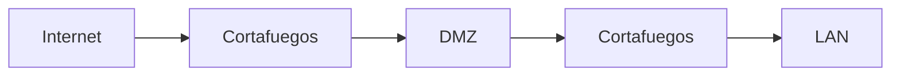

# Arquitectura y Segmentación de Red - Servicios de Torrent

## 1. Tabla de ubicación de servicios

| Servicio | Zona | Justificación |
| :--- | :--- | :--- |
| **1. Web corporativa pública** | DMZ | Debe ser accesible desde Internet por cualquier usuario externo sin exponer la red interna ante un posible compromiso. |
| **2. Servidor de correo** | DMZ | Recibe y envía tráfico SMTP desde/hacia Internet en la DMZ, mientras que el almacenamiento interno de correos y datos sensibles permanece protegido en la LAN. |
| **3. Pasarela VPN** | DMZ | Termina conexiones cifradas procedentes de empleados remotos en Internet antes de darles acceso controlado hacia la red interna. |
| **4. Proxy (saliente e inverso)** | DMZ | El proxy inverso protege y filtra peticiones entrantes de Internet hacia los servidores de la DMZ, y el saliente intermedia las salidas de la LAN. |
| **5. HMI de planta y carpeta de planos** | Zona crítica | Contiene propiedad intelectual crítica y control industrial; no requiere exposición directa a Internet y su caída paralizaría la producción. |
| **6. Autoridad de certificación (srv-ca)** | Zona crítica | Es la raíz de confianza criptográfica de toda la organización; comprometerla permitiría suplantar cualquier servicio o usuario interno. |
| **7. Servidor de copias de seguridad** | Zona crítica | Almacena todos los datos críticos de la empresa y debe estar aislado para evitar que un ataque (como ransomware) cifre los respaldos. |
| **8. Portátiles de ingenieros y operarios** | LAN | Son los equipos de trabajo diario que necesitan acceder a planos, correo y recursos internos bajo políticas de seguridad corporativas. |
| **9. Wi-Fi de invitados** | DMZ | Solo requiere salida directa a Internet para visitantes externos, debiendo estar totalmente aislada de la LAN y de los servicios de la DMZ. |
| **10. Servidor de registros y monitorización** | LAN | Recopila logs de todos los sistemas para auditoría; debe residir en la red interna para que un atacante no pueda borrar sus huellas. |

---

## 2. Tabla de flujos de red

| Origen → destino | ¿Permitido? | Ejemplo concreto |
| :--- | :--- | :--- |
| **Internet → DMZ** | **Sí** (Restringido) | Un cliente externo accede por HTTPS (puerto 443) a la web corporativa pública o envía un correo por SMTP (puerto 25). |
| **Internet → LAN** | **No** | Cualquier intento de conexión directa desde Internet hacia los portátiles de operarios o el servidor de copias de seguridad es bloqueado por defecto. |
| **DMZ → LAN** | **No** (Salvo excepciones muy estrictas) | El servidor web tiene bloqueado iniciar conexiones hacia la carpeta de planos; solo se permiten flujos puntuales y filtrados como el envío de logs (Syslog) o autenticación. |
| **LAN → DMZ** | **Sí** (Controlado) | Un ingeniero desde su portátil accede a la interfaz de administración del proxy o consulta el correo interno alojado en la DMZ. |
| **LAN → Internet** | **Sí** (A través de Proxy) | Los portátiles de los empleados navegan por páginas web externas pasando obligatoriamente por el proxy saliente en puertos 80/443. |

---

## 3. Diagrama de la red

---

## 4. Pregunta de reflexión:

si cae el servidor web, ¿qué puede hacer el atacante en tu diseño y qué se lo impide?

Su margen de maniobra quedará limitado a intentar moverse lateralmente hacia otros equipos dentro de esa misma zona perimetral.
El cortafuegos interior bloquea por defecto cualquier conexión iniciada desde la DMZ hacia la LAN.
