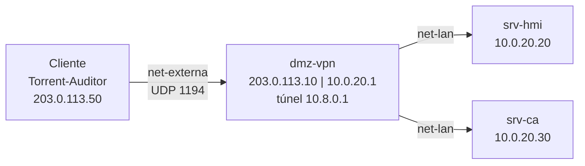

# Práctica 2 (v2) · Pasarela de acceso con OpenVPN y Easy-RSA

---

## Arquitectura y direccionamiento



| Máquina | Red `net-externa` | Red `net-lan` | Función |
| :--- | :--- | :--- | :--- |
| **`srv-ca`** | — | `10.0.20.30/24` | CA de la VPN (Easy-RSA). Firma certificados y se apaga |
| **`dmz-vpn`** | `203.0.113.10/24` | `10.0.20.1/24` | Pasarela OpenVPN (`10.8.0.1`) y cortafuegos entre redes |
| **`srv-hmi`** | — | `10.0.20.20/24` | Servicio HMI protegido (SSH + 2FA) |
| **`Cliente`** | `203.0.113.50/24` | — | Equipo del técnico externo (`Torrent-Auditor`) |

* **Red del túnel VPN:** `10.8.0.0/24`
* **Regla de oro:** `ca.key` no sale nunca de `srv-ca`, y ninguna clave privada sale de la máquina donde se generó.
* **Comprobación previa:** Verificar sincronización horaria en todas las VMs con `date`.

---

## Parte 0 · La red del laboratorio

### 0.1 Adaptadores en VirtualBox
Cada VM mantiene el **Adaptador 1 (NAT / Gestión)** para instalar paquetes y transferir ficheros con `scp`, más los siguientes adaptadores de **Red interna**:

* **`dmz-vpn`:** Adaptador 2 (`net-externa`) + Adaptador 3 (`net-lan`)
* **`srv-hmi`:** Adaptador 2 (`net-lan`)
* **`srv-ca`:** Adaptador 2 (`net-lan`)
* **`Cliente`:** Adaptador 2 (`net-externa`)

### 0.2 Direcciones IP y ruta de retorno
Comprobar nombres de interfaz con `ip -br a` y configurar en cada máquina:

```bash
# En dmz-vpn (sustituir IFACE_EXT e IFACE_LAN)
sudo ip addr add 203.0.113.10/24 dev IFACE_EXT
sudo ip link set IFACE_EXT up
sudo ip addr add 10.0.20.1/24 dev IFACE_LAN
sudo ip link set IFACE_LAN up

# En srv-hmi (incluye ruta de retorno hacia el túnel 10.8.0.0/24)
sudo ip addr add 10.0.20.20/24 dev IFACE_LAN
sudo ip link set IFACE_LAN up
sudo ip route add 10.8.0.0/24 via 10.0.20.1

# En srv-ca
sudo ip addr add 10.0.20.30/24 dev IFACE_LAN
sudo ip link set IFACE_LAN up

# En Cliente
sudo ip addr add 203.0.113.50/24 dev IFACE_EXT
sudo ip link set IFACE_EXT up
```

### Entrega 0 · Sin VPN no se llega al HMI
Con los adaptadores de gestión desconectados en VirtualBox (*desmarcar Cable conectado*), se ejecuta desde `Cliente`:

```bash
ip -br a
ping -c 2 10.0.20.20
```

[PEGAR AQUÍ CAPTURA DE ENTREGA 0: `ip -br a` y `ping` fallando en el cliente]

---

## Parte 1 · Montar la CA con Easy-RSA y emitir los certificados

### 1.1 y 1.2 Crear la CA en `srv-ca`
```bash
sudo apt update && sudo apt install -y easy-rsa
make-cadir ~/easy-rsa-ca && cd ~/easy-rsa-ca
./easyrsa init-pki
./easyrsa build-ca
# Common Name: Torrent S.L. VPN CA
```

### 1.3 Certificado de la pasarela (`dmz-vpn`)
1. **En `dmz-vpn`** (generar clave privada y CSR):
   ```bash
   sudo apt update && sudo apt install -y easy-rsa openvpn nftables
   make-cadir ~/easy-rsa && cd ~/easy-rsa
   ./easyrsa init-pki
   ./easyrsa gen-req vpn-gw nopass
   # Common Name: vpn.torrent.local
   ```
2. **En `srv-ca`** (importar y firmar con rol `server` y SAN):
   ```bash
   cd ~/easy-rsa-ca
   ./easyrsa import-req /tmp/vpn-gw.req vpn-gw
   ./easyrsa --subject-alt-name="DNS:vpn.torrent.local,IP:203.0.113.10" sign-req server vpn-gw
   ```

### 1.4 y 1.5 Certificado del cliente (`tecnico01`) y CRL inicial
1. **En `Cliente`** (generar clave privada y CSR):
   ```bash
   sudo apt update && sudo apt install -y easy-rsa openvpn
   make-cadir ~/easy-rsa && cd ~/easy-rsa
   ./easyrsa init-pki
   ./easyrsa gen-req tecnico01 nopass
   # Common Name: tecnico01
   ```
2. **En `srv-ca`** (firmar como `client` y generar CRL):
   ```bash
   cd ~/easy-rsa-ca
   ./easyrsa import-req /tmp/tecnico01.req tecnico01
   ./easyrsa sign-req client tecnico01
   ./easyrsa gen-crl
   ```
3. **Reparto de ficheros y apagado de `srv-ca`:**
   * A **`dmz-vpn`**: `ca.crt`, `vpn-gw.crt` y `crl.pem`.
   * A **`Cliente`**: `ca.crt` y `tecnico01.crt`.
   * Apagar `srv-ca` (`sudo poweroff`).

### Entrega 1 · Verificación de certificados y registro de la CA

#### (a) Salida de `openssl verify` y `-ext extendedKeyUsage` para ambos certificados
```bash
openssl verify -CAfile pki/ca.crt pki/issued/vpn-gw.crt
openssl x509 -in pki/issued/vpn-gw.crt -noout -ext extendedKeyUsage,subjectAltName
openssl verify -CAfile pki/ca.crt pki/issued/tecnico01.crt
openssl x509 -in pki/issued/tecnico01.crt -noout -ext extendedKeyUsage
```

[PEGAR AQUÍ CAPTURA DE ENTREGA 1a]

#### (b) Contenido de `pki/index.txt`
```text
# PEGAR AQUÍ LA SALIDA DE: cat pki/index.txt
```

#### (c) Diferencias entre `x509-types/server` y `x509-types/client` y por qué importan
`x509-types/server` establece `extendedKeyUsage = serverAuth` y `keyUsage = digitalSignature, keyEncipherment` (junto con `subjectAltName`), mientras que `x509-types/client` asigna únicamente `extendedKeyUsage = clientAuth` y `keyUsage = digitalSignature`. Esta diferenciación impide la suplantación de roles entre extremos, evitando que un técnico con certificado válido levante una pasarela falsa (*Man-in-the-Middle*) o que una pasarela comprometida se autentique como cliente.

---

## Parte 2 · La pasarela `dmz-vpn`

### 2.1, 2.2 y 2.3 Reenvío IP, certificados y clave `tls-crypt`
```bash
# Activar reenvío IP
echo "net.ipv4.ip_forward=1" | sudo tee /etc/sysctl.d/99-forward.conf
sudo sysctl --system

# Colocar certificados y claves con permisos seguros
sudo mkdir -p /etc/openvpn/server
sudo cp ~/ca.crt ~/vpn-gw.crt ~/crl.pem /etc/openvpn/server/
sudo cp ~/easy-rsa/pki/private/vpn-gw.key /etc/openvpn/server/
sudo chmod 600 /etc/openvpn/server/vpn-gw.key
sudo chmod 644 /etc/openvpn/server/crl.pem

# Generar clave de protección del canal de control (copiar también al cliente)
cd /etc/openvpn/server
sudo openvpn --genkey secret ta.key
sudo chmod 600 ta.key
```

### 2.4 Configuración `/etc/openvpn/server/server.conf`
```ini
port 1194
proto udp
dev tun
topology subnet
server 10.8.0.0 255.255.255.0
push "route 10.0.20.0 255.255.255.0"

ca ca.crt
cert vpn-gw.crt
key vpn-gw.key
dh none
tls-crypt ta.key
remote-cert-tls client
crl-verify crl.pem

data-ciphers AES-256-GCM:AES-128-GCM
tls-version-min 1.2

user nobody
group nogroup
persist-key
persist-tun
keepalive 10 120
verb 3
```

### Entrega 2 · Arranque y comprobación de OpenVPN
```bash
sudo systemctl enable --now openvpn-server@server
systemctl status openvpn-server@server --no-pager
ip -br a show tun0
sudo ss -ulpn | grep 1194
```

[PEGAR AQUÍ CAPTURA DE ENTREGA 2: `systemctl status`, `ip -br a show tun0` y `ss -ulpn`]

---

## Parte 3 · Cortafuegos mínimo en la pasarela

Configuración de `/etc/nftables.conf` (adaptando los nombres de interfaz `EXT`, `LAN` y `MGMT`):

```nft
#!/usr/sbin/nft -f
flush ruleset

define EXT  = "enp0s8"
define LAN  = "enp0s9"
define MGMT = "enp0s3"
define VPN  = "tun0"
define HMI  = 10.0.20.20

table inet filter {
  chain input {
    type filter hook input priority 0; policy drop;
    ct state established,related accept
    iif "lo" accept
    iifname $EXT udp dport 1194 accept
    iifname { $LAN, $MGMT } tcp dport 22 accept
    iifname $VPN icmp type echo-request accept
  }

  chain forward {
    type filter hook forward priority 0; policy drop;
    ct state established,related accept
    iifname $VPN oifname $LAN ip daddr $HMI tcp dport 22 accept
    iifname $VPN oifname $LAN ip daddr $HMI icmp type echo-request accept
  }
}
```

### Entrega 3 · Reglas activas del cortafuegos
```bash
sudo nft -c -f /etc/nftables.conf
sudo nft -f /etc/nftables.conf
sudo systemctl enable --now nftables
sudo nft list ruleset
```

```text
# PEGAR AQUÍ LA SALIDA DE: sudo nft list ruleset
```

---

## Parte 4 y Parte 5 · El cliente y comprobación de funcionamiento

### 4.1 y 4.2 Preparación de `~/vpn-torrent/cliente.conf`
```ini
client
dev tun
proto udp
remote 203.0.113.10 1194
nobind
persist-key
persist-tun

ca ca.crt
cert tecnico01.crt
key tecnico01.key
tls-crypt ta.key
remote-cert-tls server

data-ciphers AES-256-GCM:AES-128-GCM
verb 3
```

### Entrega 4 · Túnel activo, rutas y acceso SSH al HMI
Con los adaptadores de gestión desconectados en todas las VMs:

```bash
# Terminal 1 (Cliente)
cd ~/vpn-torrent
sudo openvpn --config cliente.conf

# Terminal 2 (Cliente)
ip -br a show tun0
ip route
ping -c 2 10.8.0.1
ping -c 2 10.0.20.20
ssh USUARIO@10.0.20.20
```

[PEGAR AQUÍ CAPTURA DE ENTREGA 4: `Initialization Sequence Completed`, `ip route` con `10.0.20.0/24 via tun0` y acceso SSH al HMI con 2FA]

---

## Parte 6 · Pruebas de ataque y defensa

### Entrega 5 · La ruta no es un control de acceso (6.1)
```bash
ping -c 2 10.0.20.30
nmap -Pn -p 22 10.0.20.30
nmap -Pn -p 22 10.0.20.20
sudo ip route add 192.168.99.0/24 dev tun0
ping -c 2 192.168.99.1
```

[PEGAR AQUÍ CAPTURA DE ENTREGA 5: `ping` y `nmap` hacia `10.0.20.30` (filtrado) y `10.0.20.20` (abierto)]

* **Explicación:** El cliente llega a `srv-hmi` pero no a `srv-ca` porque el anuncio `push "route 10.0.20.0 255.255.255.0"` solo indica al cliente qué paquetes enviar por `tun0`, pero el control de acceso efectivo lo impone la cadena `forward` de `nftables` en `dmz-vpn` (política `drop`), que únicamente permite tráfico SSH e ICMP hacia `10.0.20.20`.

### Entrega 6 · Qué ve un atacante en el cable (6.2)
```bash
# En dmz-vpn (mientras hay tráfico SSH desde el cliente)
sudo tcpdump -i IFACE_EXTERNA -n udp port 1194 -c 20
sudo tcpdump -i tun0 -n -c 20
```

[PEGAR AQUÍ CAPTURA DE ENTREGA 6: comparación de `tcpdump` en interfaz externa vs `tun0`]

* **Explicación de la diferencia (confidencialidad):** En `net-externa` solo se observan paquetes UDP al puerto 1194 con las IPs públicas (`203.0.113.50` y `203.0.113.10`) y carga cifrada (AES-GCM en datos y `tls-crypt` en el canal de control), ocultando las IPs internas y el contenido. En `tun0` se captura el tráfico antes de ser cifrado por el túnel, viéndose en claro las direcciones internas (`10.8.0.x` y `10.0.20.20`) y los segmentos TCP del SSH.

### Entrega 7 · Revocar un certificado (6.3)
```bash
# En srv-ca
cd ~/easy-rsa-ca
./easyrsa revoke tecnico01
./easyrsa gen-crl
openssl verify -crl_check -CAfile pki/ca.crt -CRLfile pki/crl.pem pki/revoked/certs_by_serial/NUMERO_SERIE.crt
cat pki/index.txt

# Tras copiar pki/crl.pem a /etc/openvpn/server/crl.pem en dmz-vpn y reconectar el cliente:
sudo journalctl -u openvpn-server@server -n 30 --no-pager | grep -i revoked
```

[PEGAR AQUÍ CAPTURA DE ENTREGA 7: `openssl verify` revocado, `pki/index.txt` con `R`, intento de reconexión y log `certificate revoked`]

---

## Parte 7 · Preguntas de reflexión

1. **Un atacante roba `tecnico01.key`. ¿Qué puede hacer y qué le falta para entrar?**  
   Por sí sola, la clave privada no le basta para establecer el túnel porque necesita el certificado público firmado (`tecnico01.crt`), el certificado de la CA (`ca.crt`) y la clave compartida del canal de control (`ta.key`) para superar `tls-crypt` y completar el *handshake* TLS. Además, incluso si robara toda la carpeta del cliente y conectara la VPN, el cortafuegos solo le dejaría alcanzar el SSH de `srv-hmi`, donde seguiría necesitando la contraseña del usuario y el código de segundo factor (2FA).

2. **¿Por qué `ca.key` no sale nunca de `srv-ca`? ¿Qué podría hacer alguien que la robara?**  
   Porque `ca.key` es la raíz de confianza de toda la infraestructura: cualquier certificado firmado con ella es aceptado automáticamente por la pasarela y los clientes. Si un atacante la robara y obtuviera su contraseña, podría emitir certificados de cliente válidos para entrar en la VPN sin ser detectado o certificados de servidor falsos para suplantar a `dmz-vpn` en ataques *Man-in-the-Middle*, obligando a revocar y reconstruir toda la PKI desde cero.

3. **¿Qué ocurre si la CRL caduca y nadie la renueva?**  
   Por diseño seguro (*fail-closed*), OpenVPN rechaza **todas** las conexiones entrantes de los clientes aunque sus certificados individuales sigan vigentes y no estén revocados. Al verificar `crl-verify crl.pem`, el servidor detecta que la fecha `Next Update` ha expirado y, como no puede garantizar si un certificado ha sido anulado recientemente, bloquea todos los accesos por completo.

4. **La ruta del túnel anunciaba toda la LAN. ¿Por qué eso no era un problema? ¿Qué lo habría convertido en uno?**  
   No es un problema porque el enrutamiento (`push "route"`) solo indica al cliente qué paquetes enviar hacia la pasarela, pero no concede permisos de paso; la cadena `forward` de `nftables` en `dmz-vpn` tiene política `drop` y bloquea todo lo que no vaya a `10.0.20.20` por los puertos autorizados. Se habría convertido en un problema grave si `dmz-vpn` tuviera `ip_forward=1` activo sin reglas de cortafuegos (o con política `accept`), exponiendo `srv-ca` y toda la red interna.

5. **Si cae la propia pasarela, ¿qué consigue el atacante y qué lo frena? Relaciona la respuesta con la DMZ y con los flujos que definiste en la Práctica 1.**  
   Si un atacante compromete `dmz-vpn`, obtiene su clave privada (`vpn-gw.key`), `ta.key` y capacidad de enrutar tráfico desde la DMZ hacia los flujos autorizados en la Práctica 1 (el acceso al HMI). Sin embargo, lo frena la segmentación de red y la defensa en profundidad: no consigue `ca.key` (porque `srv-ca` está aislada y apagada), su certificado `serverAuth` no le sirve para autenticarse como cliente, el cortafuegos perimetral bloquea flujos no definidos y en `srv-hmi` sigue necesitando credenciales SSH y segundo factor.

6. **Si firmaras el certificado del técnico con `sign-req server` en lugar de `sign-req client`, ¿qué podría hacer ese técnico que ahora no puede? ¿Qué mecanismo de OpenVPN lo impediría?**  
   Con `sign-req server`, su certificado incluiría `extendedKeyUsage = serverAuth`, lo que le permitiría montar una pasarela OpenVPN fraudulenta y hacerse pasar por el servidor oficial de Torrent S.L. ante otros clientes (ataque *Man-in-the-Middle*). A su vez, la directiva `remote-cert-tls client` configurada en `dmz-vpn` le impediría conectarse como técnico a la pasarela real, rechazando su conexión con un error `VERIFY EKU ERROR` al exigir `clientAuth`.
